# Vibe Video Kit · 20种代码视频模板

**先看样片，再选风格，最后直接找到源码。** 每种模板都有描述、5秒视频、模板入口和可复制的AI调用语句。

**[打开完整视频目录](https://theisadmin.github.io/vibe-video-kit/) · [观看20种风格合集](https://theisadmin.github.io/vibe-video-kit/previews/showcase.mp4) · [AI制作说明](skills/vibe-video-kit/SKILL.md)**

本项目基于 **[肖雄 XIAOXIONG / sy-styles-20](https://github.com/xiaoxiong20xx-code/sy-styles-20)** 的第一期20种场景，新增样片目录、逐项视频与源码入口、调用说明及便携适配。保留原作者署名，采用 [MIT License](LICENSE)。完整来源见 [THIRD_PARTY_NOTICES.md](THIRD_PARTY_NOTICES.md)。

## 快速开始

- 只看样片：打开上面的在线视频目录；下载ZIP后也可双击根目录 `index.html`。
- 实时预览模板：用Chrome打开 `styles/编号-风格/index.html`；复杂3D场景对显卡要求较高。
- 自己制作：安装Node.js 20或更新版本、Python、FFmpeg，建议安装Noto Sans CJK SC、Noto Serif CJK SC和Inter字体，再执行：

```sh
npm install
npm run setup
python -m pip install -r requirements.txt
node make.js list
node make.js still 09 6.5
node make.js style 09 --hwgpu
```

单帧输出在 `out/`，单个模板默认导出10秒视频。`--hwgpu` 启用硬件渲染；省略时使用兼容性较好的软件渲染，3D场景可能耗时较长。完整命令见 [上游使用说明](docs/upstream/README.md)。本仓库聚焦第一期，文档中的第二期请到原仓库使用。

用AI编程助手打开整个仓库，先读 `AGENTS.md` 和仓库内Skill，再说明你的主题和风格编号。示例：

> 按第一期01号「逐帧手绘」模板做一个故事。保留样片的材质、细节、光照、构图和镜头节奏，结合本次内容做必要替换。

## 20种模板索引

| 编号 | 风格 | 画面描述 | 视频 | 源码 |
|---|---|---|---|---|
| 01 | [逐帧手绘](#style-01) | 小房子和树从铅笔线稿变成水彩画，镜头移动后能看到空间层次。 | [播放](https://theisadmin.github.io/vibe-video-kit/#style-01) · [文件](previews/01.mp4) | [源码](styles/01-handdrawn/) |
| 02 | [等轴 2.5D](#style-02) | 悬浮小城逐步长出道路和建筑，随后从白天进入亮灯的夜晚。 | [播放](https://theisadmin.github.io/vibe-video-kit/#style-02) · [文件](previews/02.mp4) | [源码](styles/02-isometric/) |
| 03 | [扁平矢量](#style-03) | 从手里的手机推入城市，再进入房间和电脑，形成连续套层推进。 | [播放](https://theisadmin.github.io/vibe-video-kit/#style-03) · [文件](previews/03.mp4) | [源码](styles/03-flat/) |
| 04 | [线条动画](#style-04) | 暗色背景中的细线流动成山脊，亮点沿线前进，镜头穿过线条地形。 | [播放](https://theisadmin.github.io/vibe-video-kit/#style-04) · [文件](previews/04.mp4) | [源码](styles/04-lineart/) |
| 05 | [3D 渲染](#style-05) | 粉彩方块搭起领奖台，金环转动落下，玻璃珠和镜面球加入画面。 | [播放](https://theisadmin.github.io/vibe-video-kit/#style-05) · [文件](previews/05.mp4) | [源码](styles/05-3d/) |
| 06 | [形变动画](#style-06) | 发光粒子从旋涡聚成文字、灯泡和播放键，再变为“爆款”字样。 | [播放](https://theisadmin.github.io/vibe-video-kit/#style-06) · [文件](previews/06.mp4) | [源码](styles/06-morph/) |
| 07 | [贴纸风科普](#style-07) | 绿色切割垫上贴下选题、拍摄、剪辑、发布等贴纸，用箭头串起步骤。 | [播放](https://theisadmin.github.io/vibe-video-kit/#style-07) · [文件](previews/07.mp4) | [源码](styles/07-sticker/) |
| 08 | [赛博朋克 HUD](#style-08) | 无人机视角进入点云城市，扫描波点亮街区，HUD 显示仪表并锁定目标。 | [播放](https://theisadmin.github.io/vibe-video-kit/#style-08) · [文件](previews/08.mp4) | [源码](styles/08-hud/) |
| 09 | [拼贴剪贴](#style-09) | 牛皮纸桌面上叠放杂志字、照片、撕纸、标签和印章，拼成一张创作海报。 | [播放](https://theisadmin.github.io/vibe-video-kit/#style-09) · [文件](previews/09.mp4) | [源码](styles/09-collage/) |
| 10 | [弥散渐变 · 玻璃拟态](#style-10) | 极光渐变锁屏显示 9:41，玻璃卡片和透明球移动时折射、放大后方画面。 | [播放](https://theisadmin.github.io/vibe-video-kit/#style-10) · [文件](previews/10.mp4) | [源码](styles/10-glass/) |
| 11 | [几何构成 · 包豪斯](#style-11) | 红黄蓝几何碎片悬浮在白色影棚，镜头换角度后拼成完整包豪斯海报。 | [播放](https://theisadmin.github.io/vibe-video-kit/#style-11) · [文件](previews/11.mp4) | [源码](styles/11-bauhaus/) |
| 12 | [复古 · Synthwave](#style-12) | 镜头沿霓虹网格公路向条纹落日前进，山谷两侧掠过，铬金字出现。 | [播放](https://theisadmin.github.io/vibe-video-kit/#style-12) · [文件](previews/12.mp4) | [源码](styles/12-synthwave/) |
| 13 | [像素风](#style-13) | 像素角色穿过森林、平台和瀑布，最后推门通关，出现 STAGE CLEAR。 | [播放](https://theisadmin.github.io/vibe-video-kit/#style-13) · [文件](previews/13.mp4) | [源码](styles/13-pixel/) |
| 14 | [液态流动](#style-14) | 镜面液滴落下，溅起并融合，再慢慢凝成一个金属播放键。 | [播放](https://theisadmin.github.io/vibe-video-kit/#style-14) · [文件](previews/14.mp4) | [源码](styles/14-liquid/) |
| 15 | [综艺花字](#style-15) | 平底锅里煎蛋，夸张花字、拟声字和表情贴纸随动作跳出并卡点推镜。 | [播放](https://theisadmin.github.io/vibe-video-kit/#style-15) · [文件](previews/15.mp4) | [源码](styles/15-variety/) |
| 16 | [真实页面 · 2.5D 推镜](#style-16) | 剪辑软件页面拆成前后悬浮图层，光标点击，素材进入时间线，再推近预览窗。 | [播放](https://theisadmin.github.io/vibe-video-kit/#style-16) · [文件](previews/16.mp4) | [源码](styles/16-pagecam/) |
| 17 | [数据新闻 · 编辑风](#style-17) | 镜头阅读一张报纸专题：大标题、荧光标记、折线图、点阵和大数字依次展开。 | [播放](https://theisadmin.github.io/vibe-video-kit/#style-17) · [文件](previews/17.mp4) | [源码](styles/17-editorial/) |
| 18 | [水墨国风](#style-18) | 墨滴在宣纸上晕开为山峦，画出松枝、渔舟和水面，最后出现朱印。 | [播放](https://theisadmin.github.io/vibe-video-kit/#style-18) · [文件](previews/18.mp4) | [源码](styles/18-ink/) |
| 19 | [黏土定格](#style-19) | 彩泥团在蘑菇草地上揉成小鸟，保留手作痕迹，并以定格节奏活动。 | [播放](https://theisadmin.github.io/vibe-video-kit/#style-19) · [文件](previews/19.mp4) | [源码](styles/19-clay/) |
| 20 | [蓝图工程图](#style-20) | 麦克风以蓝图爆炸图展开，尺寸和引线跟随零件，组装后从图纸变成实体产品。 | [播放](https://theisadmin.github.io/vibe-video-kit/#style-20) · [文件](previews/20.mp4) | [源码](styles/20-blueprint/) |

## 样片与模板详情

以下视频是已渲染模板的5秒网页预览版，用于选择风格；源模板默认时间轴为10秒。点击图片进入视频目录，代码入口指向本仓库的对应模板。

<a id="style-01"></a>

### 01｜逐帧手绘

[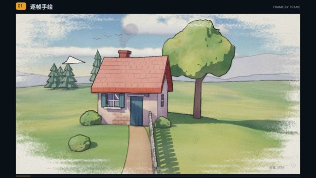](https://theisadmin.github.io/vibe-video-kit/#style-01)

小房子和树从铅笔线稿变成水彩画，镜头移动后能看到空间层次。

- **视觉特征：**纸张纹理、手绘线条、水彩上色、轻微逐帧抖动。
- **适合内容：**故事讲述、温暖开场、手作与生活话题。
- **入口：**[观看视频](https://theisadmin.github.io/vibe-video-kit/#style-01) · [视频文件](previews/01.mp4) · [模板源码](styles/01-handdrawn/) · [场景文件](styles/01-handdrawn/index.html)
- **调用语句：**按 sy-styles 第一期 01 号「逐帧手绘」模板制作这段内容。保留目录视频里的视觉效果、材质、细节、光照、构图和镜头节奏，结合本次内容做必要替换。

<a id="style-02"></a>

### 02｜等轴 2.5D

[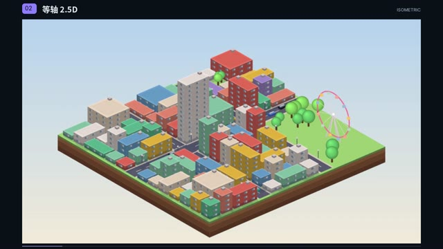](https://theisadmin.github.io/vibe-video-kit/#style-02)

悬浮小城逐步长出道路和建筑，随后从白天进入亮灯的夜晚。

- **视觉特征：**等轴视角、微缩城市、建筑弹出、昼夜变化。
- **适合内容：**城市与产业、系统结构、建设过程。
- **入口：**[观看视频](https://theisadmin.github.io/vibe-video-kit/#style-02) · [视频文件](previews/02.mp4) · [模板源码](styles/02-isometric/) · [场景文件](styles/02-isometric/index.html)
- **调用语句：**按 sy-styles 第一期 02 号「等轴 2.5D」模板制作这段内容。保留目录视频里的视觉效果、材质、细节、光照、构图和镜头节奏，结合本次内容做必要替换。

<a id="style-03"></a>

### 03｜扁平矢量

[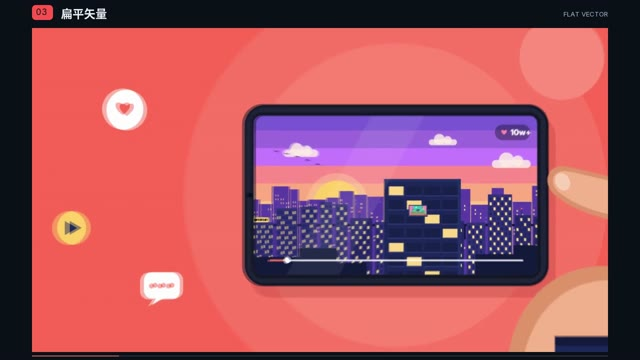](https://theisadmin.github.io/vibe-video-kit/#style-03)

从手里的手机推入城市，再进入房间和电脑，形成连续套层推进。

- **视觉特征：**大色块、清晰轮廓、矢量插画、一镜到底。
- **适合内容：**概念解释、互联网产品、流程转场。
- **入口：**[观看视频](https://theisadmin.github.io/vibe-video-kit/#style-03) · [视频文件](previews/03.mp4) · [模板源码](styles/03-flat/) · [场景文件](styles/03-flat/index.html)
- **调用语句：**按 sy-styles 第一期 03 号「扁平矢量」模板制作这段内容。保留目录视频里的视觉效果、材质、细节、光照、构图和镜头节奏，结合本次内容做必要替换。

<a id="style-04"></a>

### 04｜线条动画

[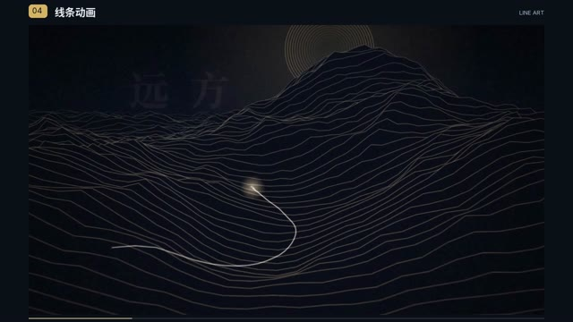](https://theisadmin.github.io/vibe-video-kit/#style-04)

暗色背景中的细线流动成山脊，亮点沿线前进，镜头穿过线条地形。

- **视觉特征：**大量细线、线条山形、深色留白、光点轨迹。
- **适合内容：**抽象概念、情绪段落、章节过渡。
- **入口：**[观看视频](https://theisadmin.github.io/vibe-video-kit/#style-04) · [视频文件](previews/04.mp4) · [模板源码](styles/04-lineart/) · [场景文件](styles/04-lineart/index.html)
- **调用语句：**按 sy-styles 第一期 04 号「线条动画」模板制作这段内容。保留目录视频里的视觉效果、材质、细节、光照、构图和镜头节奏，结合本次内容做必要替换。

<a id="style-05"></a>

### 05｜3D 渲染

[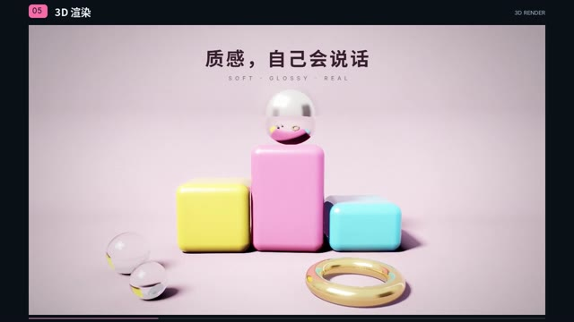](https://theisadmin.github.io/vibe-video-kit/#style-05)

粉彩方块搭起领奖台，金环转动落下，玻璃珠和镜面球加入画面。

- **视觉特征：**影棚布光、柔和阴影、糖果色、玻璃与金属材质。
- **适合内容：**产品展示、成果展示、精致的三维 B-roll。
- **入口：**[观看视频](https://theisadmin.github.io/vibe-video-kit/#style-05) · [视频文件](previews/05.mp4) · [模板源码](styles/05-3d/) · [场景文件](styles/05-3d/index.html)
- **调用语句：**按 sy-styles 第一期 05 号「3D 渲染」模板制作这段内容。保留目录视频里的视觉效果、材质、细节、光照、构图和镜头节奏，结合本次内容做必要替换。

<a id="style-06"></a>

### 06｜形变动画

[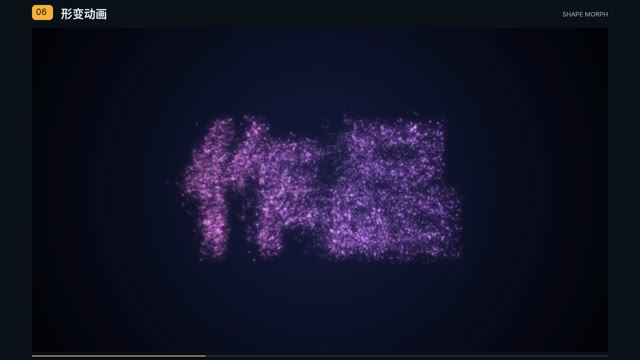](https://theisadmin.github.io/vibe-video-kit/#style-06)

发光粒子从旋涡聚成文字、灯泡和播放键，再变为“爆款”字样。

- **视觉特征：**粒子聚散、形状连续变化、深色背景、光点气流。
- **适合内容：**概念演化、关键词串联、想法到结果。
- **入口：**[观看视频](https://theisadmin.github.io/vibe-video-kit/#style-06) · [视频文件](previews/06.mp4) · [模板源码](styles/06-morph/) · [场景文件](styles/06-morph/index.html)
- **调用语句：**按 sy-styles 第一期 06 号「形变动画」模板制作这段内容。保留目录视频里的视觉效果、材质、细节、光照、构图和镜头节奏，结合本次内容做必要替换。

<a id="style-07"></a>

### 07｜贴纸风科普

[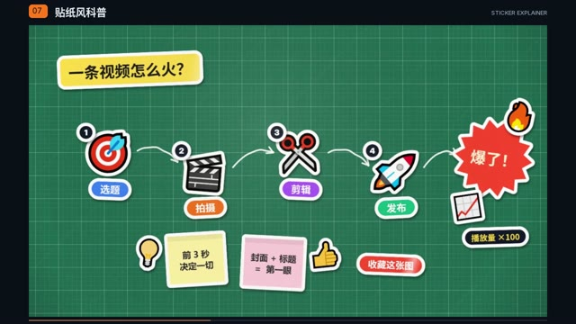](https://theisadmin.github.io/vibe-video-kit/#style-07)

绿色切割垫上贴下选题、拍摄、剪辑、发布等贴纸，用箭头串起步骤。

- **视觉特征：**白边模切贴纸、投影、马克笔箭头、镜头巡游。
- **适合内容：**步骤科普、操作教程、流程拆解。
- **入口：**[观看视频](https://theisadmin.github.io/vibe-video-kit/#style-07) · [视频文件](previews/07.mp4) · [模板源码](styles/07-sticker/) · [场景文件](styles/07-sticker/index.html)
- **调用语句：**按 sy-styles 第一期 07 号「贴纸风科普」模板制作这段内容。保留目录视频里的视觉效果、材质、细节、光照、构图和镜头节奏，结合本次内容做必要替换。

<a id="style-08"></a>

### 08｜赛博朋克 HUD

[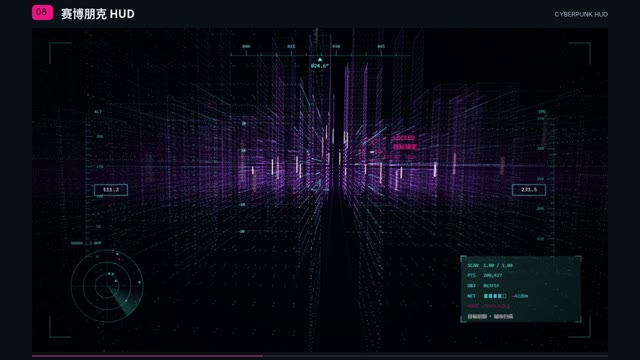](https://theisadmin.github.io/vibe-video-kit/#style-08)

无人机视角进入点云城市，扫描波点亮街区，HUD 显示仪表并锁定目标。

- **视觉特征：**点云、霓虹线框、扫描波、飞行仪表、目标框。
- **适合内容：**科技话题、AI 与数据、侦测与扫描。
- **入口：**[观看视频](https://theisadmin.github.io/vibe-video-kit/#style-08) · [视频文件](previews/08.mp4) · [模板源码](styles/08-hud/) · [场景文件](styles/08-hud/index.html)
- **调用语句：**按 sy-styles 第一期 08 号「赛博朋克 HUD」模板制作这段内容。保留目录视频里的视觉效果、材质、细节、光照、构图和镜头节奏，结合本次内容做必要替换。

<a id="style-09"></a>

### 09｜拼贴剪贴

[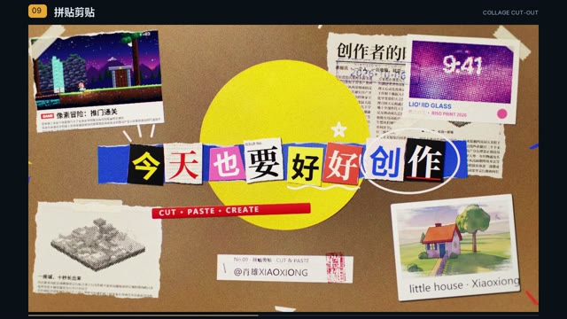](https://theisadmin.github.io/vibe-video-kit/#style-09)

牛皮纸桌面上叠放杂志字、照片、撕纸、标签和印章，拼成一张创作海报。

- **视觉特征：**纸边纤维、剪贴层次、印刷网点、桌面光影。
- **适合内容：**创作主题、旅行记录、手账与海报。
- **入口：**[观看视频](https://theisadmin.github.io/vibe-video-kit/#style-09) · [视频文件](previews/09.mp4) · [模板源码](styles/09-collage/) · [场景文件](styles/09-collage/index.html)
- **调用语句：**按 sy-styles 第一期 09 号「拼贴剪贴」模板制作这段内容。保留目录视频里的视觉效果、材质、细节、光照、构图和镜头节奏，结合本次内容做必要替换。

<a id="style-10"></a>

### 10｜弥散渐变 · 玻璃拟态

[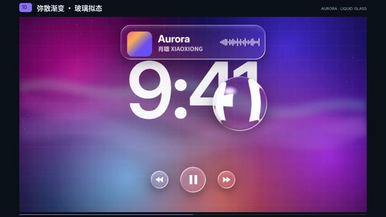](https://theisadmin.github.io/vibe-video-kit/#style-10)

极光渐变锁屏显示 9:41，玻璃卡片和透明球移动时折射、放大后方画面。

- **视觉特征：**弥散渐变、透明圆角卡片、磨砂与液态玻璃、折射。
- **适合内容：**数字产品、界面展示、精致科技感。
- **入口：**[观看视频](https://theisadmin.github.io/vibe-video-kit/#style-10) · [视频文件](previews/10.mp4) · [模板源码](styles/10-glass/) · [场景文件](styles/10-glass/index.html)
- **调用语句：**按 sy-styles 第一期 10 号「弥散渐变 · 玻璃拟态」模板制作这段内容。保留目录视频里的视觉效果、材质、细节、光照、构图和镜头节奏，结合本次内容做必要替换。

<a id="style-11"></a>

### 11｜几何构成 · 包豪斯

[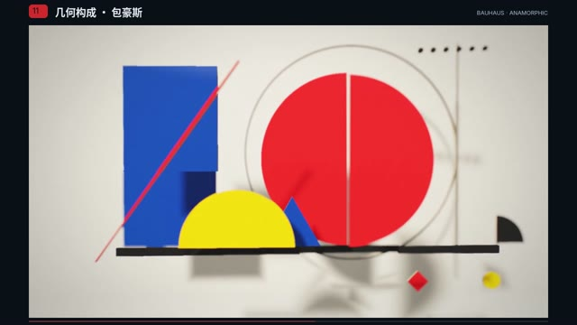](https://theisadmin.github.io/vibe-video-kit/#style-11)

红黄蓝几何碎片悬浮在白色影棚，镜头换角度后拼成完整包豪斯海报。

- **视觉特征：**三原色、几何块面、抽象雕塑、透视对齐。
- **适合内容：**设计话题、品牌概念、艺术化片头。
- **入口：**[观看视频](https://theisadmin.github.io/vibe-video-kit/#style-11) · [视频文件](previews/11.mp4) · [模板源码](styles/11-bauhaus/) · [场景文件](styles/11-bauhaus/index.html)
- **调用语句：**按 sy-styles 第一期 11 号「几何构成 · 包豪斯」模板制作这段内容。保留目录视频里的视觉效果、材质、细节、光照、构图和镜头节奏，结合本次内容做必要替换。

<a id="style-12"></a>

### 12｜复古 · Synthwave

[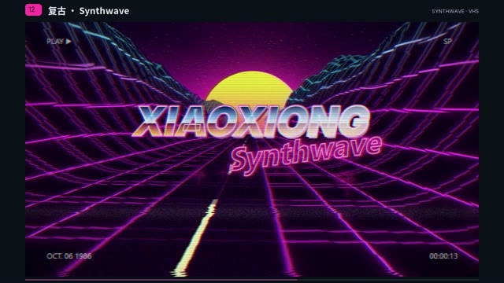](https://theisadmin.github.io/vibe-video-kit/#style-12)

镜头沿霓虹网格公路向条纹落日前进，山谷两侧掠过，铬金字出现。

- **视觉特征：**紫粉霓虹、发光网格、条纹落日、VHS 录像带质感。
- **适合内容：**复古科技、游戏主题、节奏片头。
- **入口：**[观看视频](https://theisadmin.github.io/vibe-video-kit/#style-12) · [视频文件](previews/12.mp4) · [模板源码](styles/12-synthwave/) · [场景文件](styles/12-synthwave/index.html)
- **调用语句：**按 sy-styles 第一期 12 号「复古 · Synthwave」模板制作这段内容。保留目录视频里的视觉效果、材质、细节、光照、构图和镜头节奏，结合本次内容做必要替换。

<a id="style-13"></a>

### 13｜像素风

[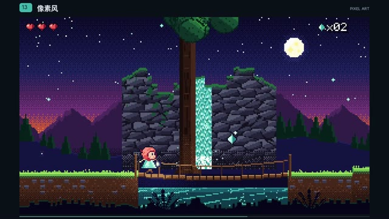](https://theisadmin.github.io/vibe-video-kit/#style-13)

像素角色穿过森林、平台和瀑布，最后推门通关，出现 STAGE CLEAR。

- **视觉特征：**低分辨率像素、横向卷轴、分层视差、复古游戏。
- **适合内容：**游戏内容、成长闯关、轻松叙事。
- **入口：**[观看视频](https://theisadmin.github.io/vibe-video-kit/#style-13) · [视频文件](previews/13.mp4) · [模板源码](styles/13-pixel/) · [场景文件](styles/13-pixel/index.html)
- **调用语句：**按 sy-styles 第一期 13 号「像素风」模板制作这段内容。保留目录视频里的视觉效果、材质、细节、光照、构图和镜头节奏，结合本次内容做必要替换。

<a id="style-14"></a>

### 14｜液态流动

[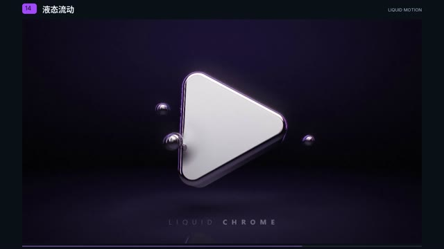](https://theisadmin.github.io/vibe-video-kit/#style-14)

镜面液滴落下，溅起并融合，再慢慢凝成一个金属播放键。

- **视觉特征：**暗场反光、液态金属、圆润融合、慢动作形变。
- **适合内容：**品牌标识、产品质感、片头与转场。
- **入口：**[观看视频](https://theisadmin.github.io/vibe-video-kit/#style-14) · [视频文件](previews/14.mp4) · [模板源码](styles/14-liquid/) · [场景文件](styles/14-liquid/index.html)
- **调用语句：**按 sy-styles 第一期 14 号「液态流动」模板制作这段内容。保留目录视频里的视觉效果、材质、细节、光照、构图和镜头节奏，结合本次内容做必要替换。

<a id="style-15"></a>

### 15｜综艺花字

[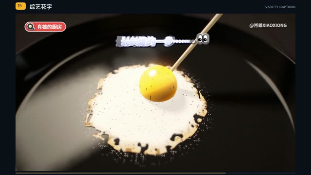](https://theisadmin.github.io/vibe-video-kit/#style-15)

平底锅里煎蛋，夸张花字、拟声字和表情贴纸随动作跳出并卡点推镜。

- **视觉特征：**多层描边文字、弹跳、漫画速度线、综艺节奏。
- **适合内容：**轻松口播、美食、吐槽与重点强调。
- **入口：**[观看视频](https://theisadmin.github.io/vibe-video-kit/#style-15) · [视频文件](previews/15.mp4) · [模板源码](styles/15-variety/) · [场景文件](styles/15-variety/index.html)
- **调用语句：**按 sy-styles 第一期 15 号「综艺花字」模板制作这段内容。保留目录视频里的视觉效果、材质、细节、光照、构图和镜头节奏，结合本次内容做必要替换。

<a id="style-16"></a>

### 16｜真实页面 · 2.5D 推镜

[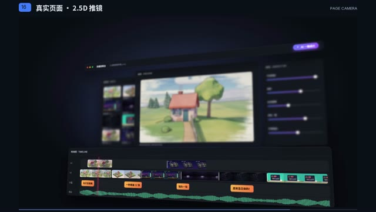](https://theisadmin.github.io/vibe-video-kit/#style-16)

剪辑软件页面拆成前后悬浮图层，光标点击，素材进入时间线，再推近预览窗。

- **视觉特征：**真实页面、分层空间、光标演示、景深切换与推镜。
- **适合内容：**软件教学、工具介绍、界面操作展示。
- **入口：**[观看视频](https://theisadmin.github.io/vibe-video-kit/#style-16) · [视频文件](previews/16.mp4) · [模板源码](styles/16-pagecam/) · [场景文件](styles/16-pagecam/index.html)
- **调用语句：**按 sy-styles 第一期 16 号「真实页面 · 2.5D 推镜」模板制作这段内容。保留目录视频里的视觉效果、材质、细节、光照、构图和镜头节奏，结合本次内容做必要替换。

<a id="style-17"></a>

### 17｜数据新闻 · 编辑风

[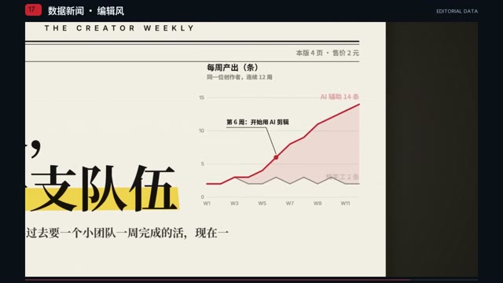](https://theisadmin.github.io/vibe-video-kit/#style-17)

镜头阅读一张报纸专题：大标题、荧光标记、折线图、点阵和大数字依次展开。

- **视觉特征：**衬线标题、报纸双栏、红黑配色、图表生长。
- **适合内容：**数据解读、研究结论、新闻与观点。
- **入口：**[观看视频](https://theisadmin.github.io/vibe-video-kit/#style-17) · [视频文件](previews/17.mp4) · [模板源码](styles/17-editorial/) · [场景文件](styles/17-editorial/index.html)
- **调用语句：**按 sy-styles 第一期 17 号「数据新闻 · 编辑风」模板制作这段内容。保留目录视频里的视觉效果、材质、细节、光照、构图和镜头节奏，结合本次内容做必要替换。

<a id="style-18"></a>

### 18｜水墨国风

[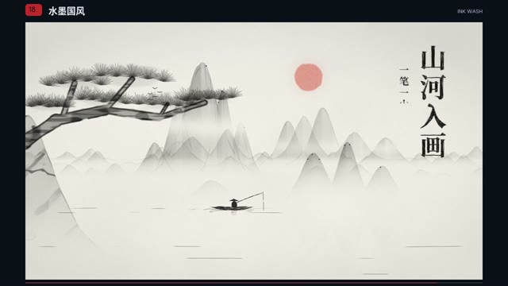](https://theisadmin.github.io/vibe-video-kit/#style-18)

墨滴在宣纸上晕开为山峦，画出松枝、渔舟和水面，最后出现朱印。

- **视觉特征：**宣纸、淡墨层次、山水留白、书法题字与红印。
- **适合内容：**传统文化、诗词、历史与意境表达。
- **入口：**[观看视频](https://theisadmin.github.io/vibe-video-kit/#style-18) · [视频文件](previews/18.mp4) · [模板源码](styles/18-ink/) · [场景文件](styles/18-ink/index.html)
- **调用语句：**按 sy-styles 第一期 18 号「水墨国风」模板制作这段内容。保留目录视频里的视觉效果、材质、细节、光照、构图和镜头节奏，结合本次内容做必要替换。

<a id="style-19"></a>

### 19｜黏土定格

[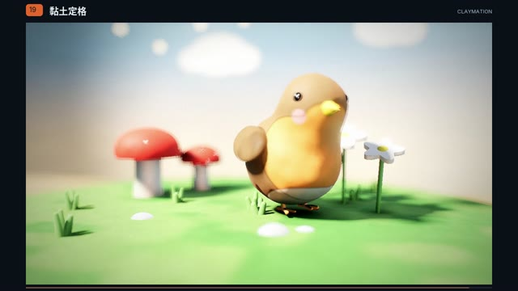](https://theisadmin.github.io/vibe-video-kit/#style-19)

彩泥团在蘑菇草地上揉成小鸟，保留手作痕迹，并以定格节奏活动。

- **视觉特征：**黏土质感、指纹、圆润造型、定格抖动、微距景深。
- **适合内容：**轻科普、童趣故事、亲切的角色演示。
- **入口：**[观看视频](https://theisadmin.github.io/vibe-video-kit/#style-19) · [视频文件](previews/19.mp4) · [模板源码](styles/19-clay/) · [场景文件](styles/19-clay/index.html)
- **调用语句：**按 sy-styles 第一期 19 号「黏土定格」模板制作这段内容。保留目录视频里的视觉效果、材质、细节、光照、构图和镜头节奏，结合本次内容做必要替换。

<a id="style-20"></a>

### 20｜蓝图工程图

[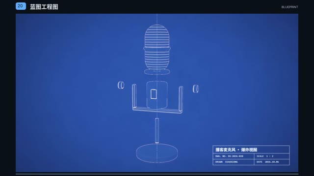](https://theisadmin.github.io/vibe-video-kit/#style-20)

麦克风以蓝图爆炸图展开，尺寸和引线跟随零件，组装后从图纸变成实体产品。

- **视觉特征：**蓝底白线、尺寸标注、零件爆炸图、蓝图到实物。
- **适合内容：**机械结构、硬件拆解、产品原理。
- **入口：**[观看视频](https://theisadmin.github.io/vibe-video-kit/#style-20) · [视频文件](previews/20.mp4) · [模板源码](styles/20-blueprint/) · [场景文件](styles/20-blueprint/index.html)
- **调用语句：**按 sy-styles 第一期 20 号「蓝图工程图」模板制作这段内容。保留目录视频里的视觉效果、材质、细节、光照、构图和镜头节奏，结合本次内容做必要替换。

## 修改与渲染

文字和部分配置位于每个场景顶部的 `Reel.cfg({...})`。改动主题时，按内容调整对象、动作和叙事时间；保留所选风格的材质、光照、构图与细节完成度。修改后先看多个时间点的单帧，再导出视频。

```sh
node make.js still 09 1
node make.js still 09 5
node make.js still 09 9
node make.js style 09 --hwgpu --force
```

`BROWSER_EXECUTABLE` 可指定现有Chrome可执行文件；未设置时使用Playwright安装的Chromium。`FFMPEG_BINARY` 可指定FFmpeg可执行文件；未设置时从PATH寻找。字体不足时会回退到系统字体，外观可能有差异。

## 本地目录与自检

```sh
npm run serve
# 浏览器打开 http://127.0.0.1:4173
npm run check
```

`styles/` 是第一期20套场景，`lib/` 是公共绘图代码，`audio/` 是程序音乐与音效，`previews/` 是样片与缩略图。`catalog.json` 记录每个模板的描述、文件路径和校验值。依赖、渲染缓存和本机配置由使用者本地生成。

## 许可与贡献

模板及共享代码原作者：**肖雄 XIAOXIONG**。本仓库由theIsAdmin整理并新增目录、调用说明和便携适配。使用、修改和再分发时保留相关版权声明和MIT许可。欢迎提交问题与改进；提交视觉改动时附上前后样帧或短样片，方便判断效果。
